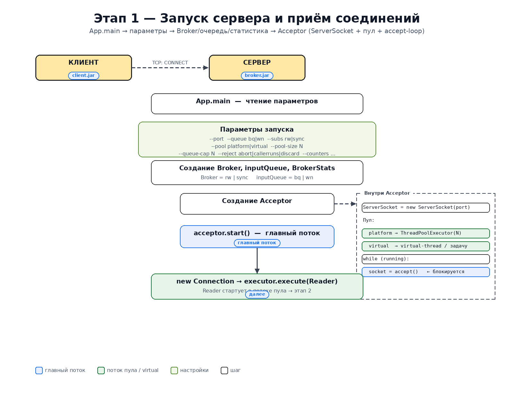
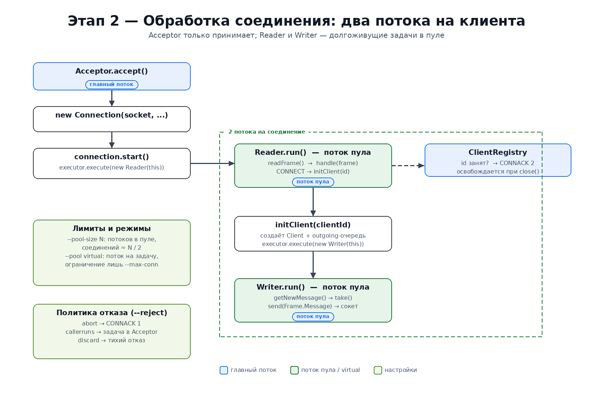
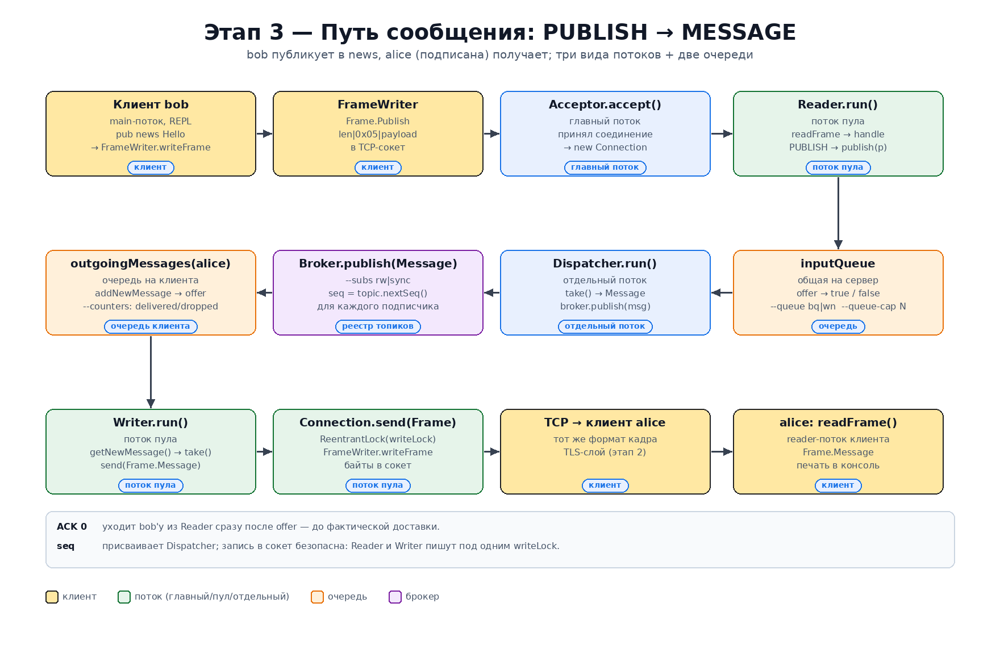
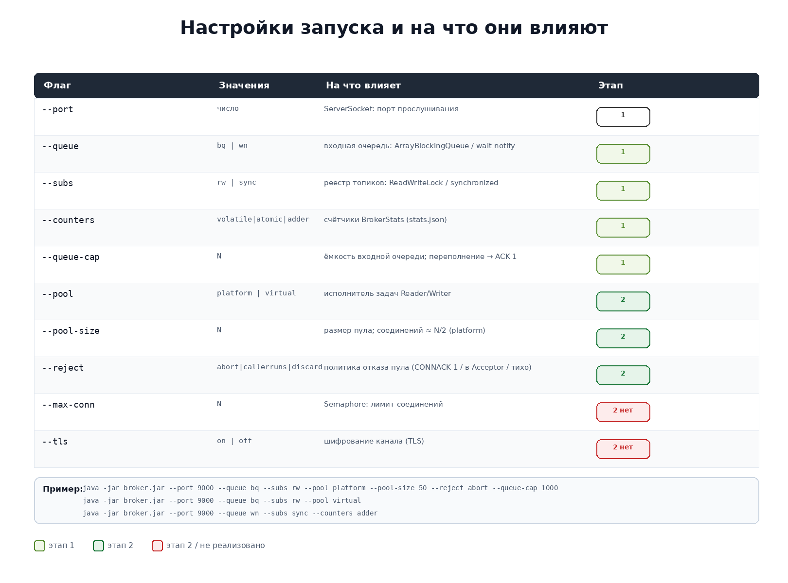
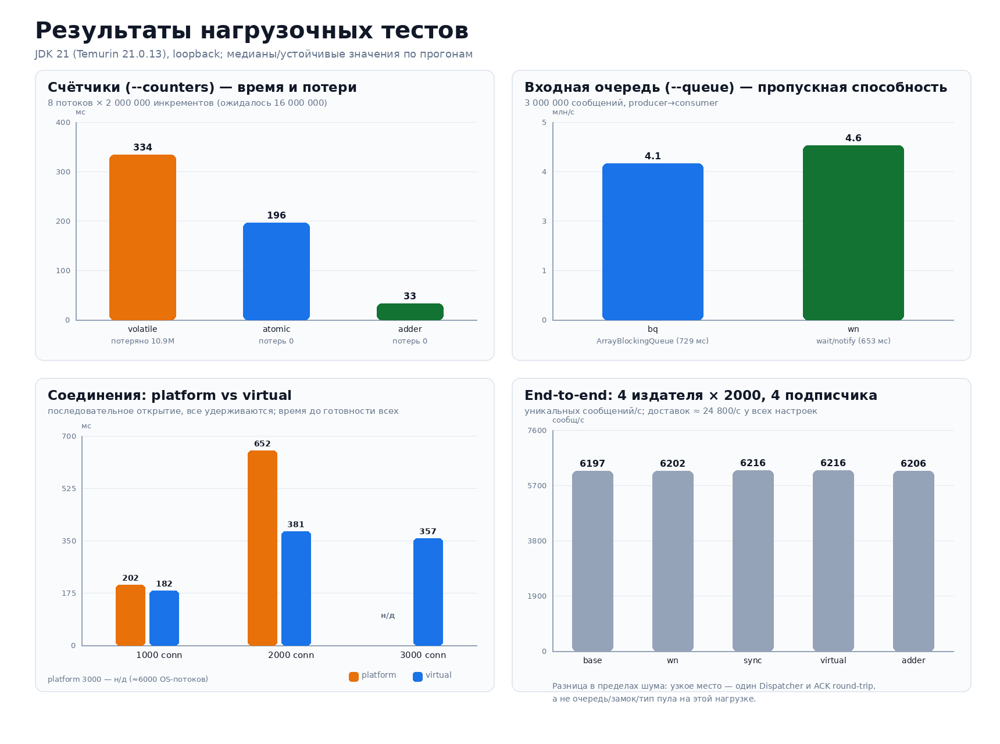
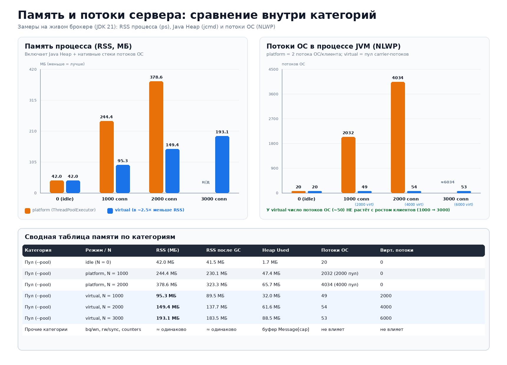
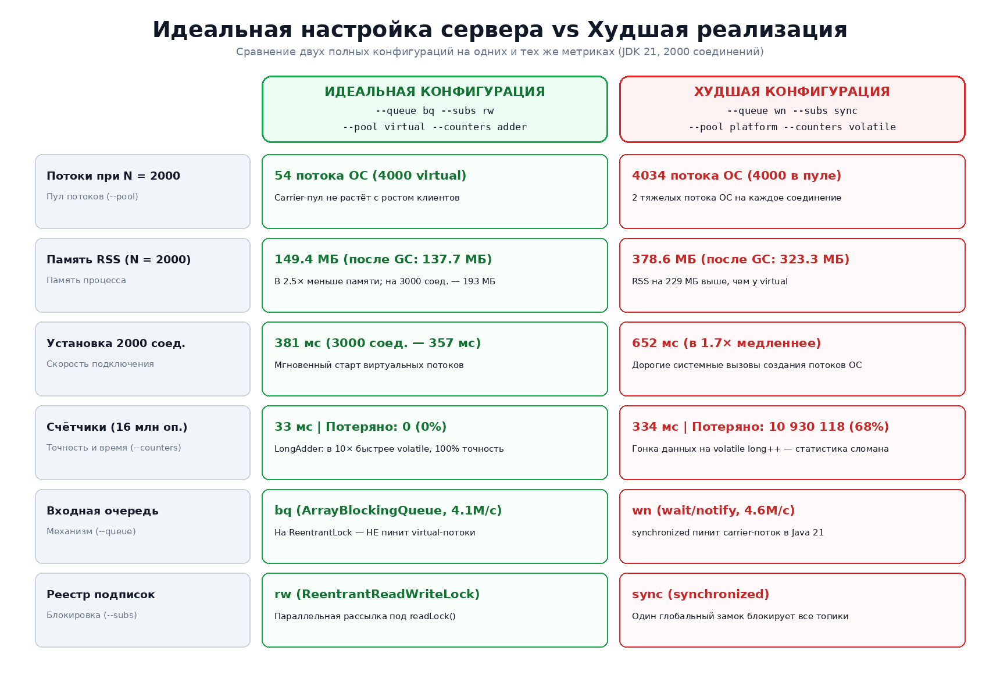

# messageBroker

Мини-брокер сообщений **pub/sub** на Java 21: сервер принимает TCP-подключения, клиенты создают топики, подписываются и публикуют сообщения. Реализован собственный бинарный протокол поверх TCP, несколько моделей очередей, подписок, пула потоков и счётчиков — чтобы сравнить их на практике.



## Возможности

- Бинарный протокол с кадрами: `4 байта длины | 1 байт типа | payload` (big-endian, кадр до 1 МиБ).
- Топики: создание, список, подписка/отписка, публикация.
- Гарантия уникальности `clientId` — повторный CONNECT получает `CONNACK 2`.
- Первый кадр обязан быть `CONNECT`, иначе соединение закрывается.
- Ограничение входной очереди: при переполнении публикация получает `ACK 1`.
- Отбрасывание сообщений медленным подписчикам со счётчиком `messagesDropped`.
- Два типа очереди (`bq` / `wn`), два брокера (`rw` / `sync`), два режима пула (`platform` / `virtual`).
- Три реализации счётчиков: `volatile`, `atomic`, `adder`.
- Статистика в `stats.json` при завершении работы.
- Тесты на очередь и статистику (JUnit 5).

## Требования

- JDK 21 (проект собирается с `--release 21`, виртуальные потоки требуют Java 21).
- Maven 3.9+.

## Быстрый старт

```bash
# сборка исполняемых jar
make jar

# сервер (по умолчанию: порт 9000, bq, rw, platform, pool-size 50)
java -jar target/broker.jar --port 9000 --queue bq --subs rw --pool platform --pool-size 50

# сервер на виртуальных потоках
java -jar target/broker.jar --port 9000 --queue bq --subs rw --pool virtual

# клиент
java -jar target/client.jar --host localhost --port 9000 --id alice
```

Пример сессии с двумя клиентами:

```text
# alice
create news
sub news
pub news привет

# bob
sub news

# оба получат
Message[topic=news, seq=1, senderId=alice]: привет
```

Команды клиента: `connect`, `create`, `topics` (`list`), `sub` (`subscribe`), `unsub` (`unsubscribe`), `pub` (`publish`), `quit` (`disconnect` / `exit`).

## Архитектура

Сервер: главный поток принимает подключения, а каждое соединение обслуживают два долгоживущих потока — `Reader` и `Writer`. Общая очередь `inputQueue` и отдельный `Dispatcher` развязывают приём сообщений и их доставку подписчикам.



Путь сообщения от публикации до подписчика:



```text
Reader (PUBLISH) ──offer──▶ inputQueue ──take──▶ Dispatcher ──▶ Broker
                                                                 │
                                              outgoing-очередь каждого подписчика
                                                                 │
Writer ◀──────────────────── take ◀──────────────────────────────┘
```

`ACK 0` означает, что сообщение принято во входную очередь, а не доставлено подписчикам.

## Протокол

Кадр: `length` (4 байта, big-endian, включает тип и payload) + `type` (1 байт) + `payload`. Строки — `u16` длина + UTF-8.

| Тип | Код | Payload |
|---|---:|---|
| CONNECT | `0x01` | clientId |
| CONNACK | `0x02` | status |
| SUBSCRIBE | `0x03` | requestId, topic |
| UNSUBSCRIBE | `0x04` | requestId, topic |
| PUBLISH | `0x05` | requestId, topic, body |
| MESSAGE | `0x06` | topic, seq, senderId, body |
| ACK | `0x07` | requestId, status |
| DISCONNECT | `0x08` | — |
| CREATE_TOPIC | `0x09` | requestId, topic |
| LIST_TOPICS | `0x0A` | requestId |
| TOPIC_LIST | `0x0B` | requestId, count, topics |

Коды ответа:

| CONNACK | Значение |
|---:|---|
| 0 | Успешное подключение |
| 1 | Отказ: пул переполнен |
| 2 | Ошибка: `clientId` занят |

| ACK | Значение |
|---:|---|
| 0 | Принято во входную очередь |
| 1 | Переполнение входной очереди |
| 2 | Ошибка / некорректное имя |
| 3 | Топик не найден |
| 4 | Топик уже существует |

## Параметры запуска

| Флаг | Значения | По умолчанию | Описание |
|---|---|---|---|
| `--port` | число | `9000` | Порт сервера |
| `--queue` | `bq`, `wn` | `bq` | Очередь: `ArrayBlockingQueue` / собственная |
| `--subs` | `rw`, `sync` | `rw` | Брокер: `ReentrantReadWriteLock` / `synchronized` |
| `--pool` | `platform`, `virtual` | `platform` | Пул потоков |
| `--pool-size` | число | `50` | Размер пула (≈ N/2 подключений) |
| `--reject` | `abort`, `callerruns`, `discard` | `abort` | Политика отказа пула |
| `--queue-cap` | число | `1000` | Ёмкость входной очереди |
| `--counters` | `volatile`, `atomic`, `adder` | `atomic` | Реализация счётчиков |
| `--max-conn` | число | `0` | Лимит подключений (ещё не реализован) |

При `--pool virtual` параметры `--pool-size` и `--reject` не применяются: на каждую задачу создаётся виртуальный поток, а `--queue-cap` задаёт ёмкость `inputQueue`.

## Статистика

При завершении сервер пишет `stats.json`:

```json
{
  "counterMode": "atomic",
  "connectionsAccepted": 2,
  "connectionsRejected": 0,
  "messagesPublished": 1,
  "messagesDelivered": 1,
  "messagesDropped": 0,
  "uptimeSeconds": 3895,
  "topics": {
    "news": {"published": 1, "delivered": 1, "dropped": 0}
  },
  "config": {
    "counters": "atomic", "maxConn": "0", "pool": "virtual",
    "poolSize": "50", "port": "9000", "queue": "bq",
    "queueCap": "1000", "reject": "abort", "subs": "rw"
  }
}
```

## Результаты замеров

Сравнение внутри одной категории; loopback, JDK 21.



| Счётчики, 16 млн инкрементов | Время | Потеряно |
|---|---:|---:|
| `volatile` | 334 мс | 10 930 118 |
| `atomic` | 196 мс | 0 |
| `adder` | 33 мс | 0 |

| Очередь, 3 млн сообщений | Время | Пропускная способность |
|---|---:|---:|
| `bq` | 729 мс | 4 115 226/с |
| `wn` | 653 мс | 4 594 181/с |



Память на 1000 / 2000 / 3000 подключений:



| Режим | Подключений | RSS | Потоки ОС | Heap |
|---|---:|---:|---:|---:|
| platform | 1000 | 244.4 МБ | 2032 | 47.4 МБ |
| platform | 2000 | 378.6 МБ | 4034 | 65.7 МБ |
| virtual | 1000 | 95.3 МБ | 49 | 32.0 МБ |
| virtual | 2000 | 149.4 МБ | 54 | 61.6 МБ |
| virtual | 3000 | 193.1 МБ | 53 | 88.5 МБ |



Скорость доставки в end-to-end тесте (4 публикатора × 2000 сообщений, 4 подписчика) практически одинакова для всех конфигураций — около 6.2 тыс. уникальных сообщений/с. Узкое место — один `Dispatcher` и ожидание `ACK`, а не потоки `Reader`/`Writer`.

## Структура проекта

```text
src/main/java/com/miet/tpp/messagebroker/
├── App.java                 # точка входа сервера, разбор флагов
├── brokerQueue/             # IBlockingQueue, ArrayBlockingMessageQueue, CustomBlockingQueue
├── client/                  # InteractiveClient, TestClient
├── codec/                   # Frame, FrameReader/Writer, Reader, Writer
├── messages/                # Broker, ReentrantRWBroker, SynchronizedBroker, Topic, Message, Client
├── server/                  # Acceptor, Connection, Dispatcher, ClientRegistry, пул
└── stats/                   # Counter, BrokerStats
```

## Материалы

- `message_broker_presentation.pptx` — презентация (14 слайдов).
- `message_broker_speaker_notes.pdf` — тезисы к каждому слайду.

## Тесты

```bash
make test
```

## Ограничения

- TLS не реализован: трафик передаётся по TCP в открытом виде.
- `--max-conn` пока только разбирается и выводит предупреждение.
